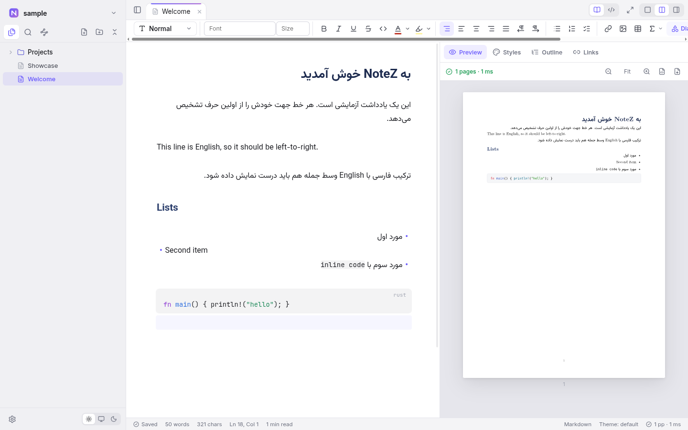

# NoteZ

A bilingual (Persian + English) note-taking app for Linux with LaTeX-quality PDF
export. Notes are plain Markdown or [Typst](https://typst.app) files in a
folder; the PDF engine is Typst, embedded — no TeX installation needed.



## Features

- **Persian & English side by side** — every line picks its own direction
  (RTL/LTR), in the editor and in the PDF.
- **Beautiful PDF** — Markdown and `.typ` notes are typeset by embedded Typst,
  with a live PDF preview next to the editor.
- **Word-like styling** — a ribbon toolbar (fonts, sizes, colors, alignment,
  direction) and Word-style paragraph styles (Title, Heading 1–6, …) with
  fonts, sizes, colors, spacing and numbering, saved as document themes.
- **Live preview editing** (Obsidian-style) — syntax hides off the cursor line;
  editable tables, callouts, math (KaTeX / LaTeX syntax), images, and an
  editable Properties card for the frontmatter.
- **Charts & diagrams** — ` ```chart `, ` ```mermaid `, ` ```diagram ` (Fletcher)
  and ` ```draw ` (CeTZ) blocks, rendered inline and in the PDF; a gallery and
  a `/` menu to insert them.
- **Obsidian-friendly** — opens existing vaults: `[[wikilinks]]`, embeds,
  callouts, `%%comments%%`, `==highlights==`, templates with `{{date:…}}`.
  Renaming a note or folder updates the links to it.
- **Vault tools** — fast search (Persian letter variants match), backlinks,
  outline, graph view, templates, paste/drop images, focus mode.
- **Plugins** — features are plugins on a public TypeScript API; add your own
  in `<vault>/.notez/plugins/` (see [docs/PLUGINS.md](docs/PLUGINS.md)).

## Install

Download a package from [Releases](https://github.com/Reodus/NoteZ/releases)
(Linux: `.rpm`, `.deb` or `.AppImage`; Windows: `NoteZ Setup <version>.exe` installer
or portable `NoteZ <version>.exe`), or build it yourself:

## Build

Requirements: Node.js 20+, Rust (stable, edition 2024), and on Fedora
`libxcrypt-compat` for building the `.rpm`/`.deb` packages.

```sh
npm install
npm run dev      # build the core, start Vite + Electron (F12 = devtools)
npm run dist     # packages (deb, rpm, AppImage) into release/
```

Other commands:

- `npm run build` — build the UI (`dist/`) and the core (`core/bin/notez-core`)
- `npm start` — run Electron on the built UI
- `npm run clean` — delete build output
- `notez <vault> [note]` — open a vault (and a note) from the command line

Tip: Cargo's build folder grows to several GB. To keep it out of the project,
create `.cargo/config.toml` in the project root (it is git-ignored):

```toml
[build]
target-dir = "/home/<you>/.cache/notez/target"
```

If `npm install` skips Electron's download (npm 11 blocks install scripts), run
`node node_modules/electron/install.js`.

## Releasing

Packages are built by GitHub Actions ([`.github/workflows/release.yml`](.github/workflows/release.yml))
when a version tag is pushed. Bump `version` in `package.json` and
`core/Cargo.toml`, commit, then:

```sh
git tag v0.4.0
git push origin main v0.4.0
```

The Linux packages and the Windows installer/portable `.exe` appear on the
Releases page a few minutes later.
An existing tag can be rebuilt from the Actions tab (Release → Run workflow).

## Layout

- `electron/` — desktop shell: window, dialogs, file protocol, vault watcher
- `src/` — UI (SolidJS + CodeMirror 6)
- `core/` — Rust core: vault, note index, Markdown → Typst, PDF/SVG rendering.
  Runs as a helper process speaking JSON lines over stdio.
- `core/typst-packages/` — bundled Typst packages (CeTZ, Fletcher, Lilaq, MiTeX, …),
  so everything works offline
- `examples/sample-vault/` — a small vault with a sample plugin

## License

[MIT](LICENSE). Bundled fonts and Typst packages keep their own licenses
(see the license files next to them; Vazirmatn is under the SIL OFL).
