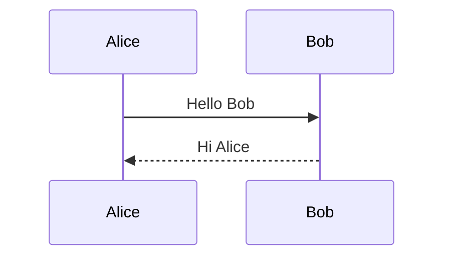

# Writing notes in NoteZ

Everything the toolbar, the right-click menu and the `/` menu do is plain
text in the note. This guide lists every rule you can type yourself. It covers
standard Markdown, the Obsidian extras NoteZ understands, and the NoteZ
extensions for styling, layout, annotations, charts and PDF output.

Notes are `.md` (Markdown, covered here) or `.typ` ([Typst](https://typst.app/docs),
written as plain Typst). Each example below shows what to type. Unless marked
**editor only**, it also appears in the PDF preview and export.

- [Text formatting](#text-formatting)
- [Headings and paragraphs](#headings-and-paragraphs)
- [Lists and tasks](#lists-and-tasks)
- [Links and embeds](#links-and-embeds)
- [Images and PDFs](#images-and-pdfs)
- [Tables](#tables)
- [Quotes and callouts](#quotes-and-callouts)
- [Annotating notes](#annotating-notes)
- [Styled text: spans](#styled-text-spans)
- [Layout blocks: divs](#layout-blocks-divs)
- [Languages and direction](#languages-and-direction)
- [Math](#math)
- [Code](#code)
- [Charts and diagrams](#charts-and-diagrams)
- [Page breaks, table of contents, spacing](#page-breaks-table-of-contents-spacing)
- [Frontmatter (properties)](#frontmatter-properties)
- [Templates](#templates)
- [Keyboard shortcuts](#keyboard-shortcuts)
- [Quick reference](#quick-reference)

---

## Text formatting

| Type this                | You get                    |
|--------------------------|----------------------------|
| `**bold**` or `__bold__` | **bold**                   |
| `*italic*` or `_italic_` | *italic*                   |
| `***bold italic***`      | ***bold italic***          |
| `~~struck~~`             | ~~struck~~                 |
| `<u>underlined</u>`      | underlined                 |
| `==highlighted==`        | highlighted (yellow)       |
| `` `code` ``             | `code`                     |
| `x^2^`                   | x² (superscript)           |
| `H~2~O`                  | H₂O (subscript)            |
| `line one<br>line two`   | a line break inside a paragraph |

Notes:

- `==highlight==` needs text right after the opening `==` and right before the
  closing one: `== x ==` stays as typed.
- Markup is not applied inside `` `inline code` `` or code blocks.
- For colors, font sizes and other styling, use a [span](#styled-text-spans).

## Headings and paragraphs

```markdown
# Heading 1
## Heading 2
### Heading 3
#### Heading 4
##### Heading 5
###### Heading 6
```

- A blank line starts a new paragraph. A single line break inside a
  paragraph is joined with a space, as in all Markdown.
- Give a heading an ID for links with `## Results {#results}`. Without one,
  a heading can still be linked by its text (see [links](#links-and-embeds)).
- A horizontal rule is `---` on its own line, with a blank line above it so it
  isn't read as a heading underline.
- The font, size, color, spacing and numbering of each heading level come from
  the note's theme (**Styles** in the toolbar, or `styles:` in the
  [frontmatter](#frontmatter-properties)), not from the Markdown.

## Lists and tasks

```markdown
- bullet
- another
  - nested (indent two spaces)

1. first
2. second
   1. nested

7. a list can start at any number

- [ ] task to do
- [x] finished task
```

`*` and `+` also work as bullets, and `1)` works as a number. Indent text
under an item to keep it part of the item.

## Links and embeds

```markdown
[NoteZ on GitHub](https://github.com/Reodus/NoteZ)   external link
<https://typst.app>                                  bare URL

[[Other note]]                     link to a note (by name, no extension)
[[Folder/Other note]]              when the name isn't unique
[[Other note|shown text]]          with different text
[[Other note#Some heading]]        to a heading in another note
[[#Some heading]]                  to a heading in this note
[[Other note#^block-id]]           to one block (paragraph, list item…) of a note
[jump](#some-heading)              Markdown-style heading link

![[Other note]]                    show a note inside this one
![[Other note#Some heading]]       … one heading's section
![[Other note#^block-id]]          … one block
```

- Type `((` to search every block of the vault and link to one; see
  [Blocks, references and embeds](BLOCKS.md).
- Renaming a note or folder in NoteZ rewrites the links that point to it.
- In the PDF, links to headings in the same note are clickable. Links to
  other notes are shown in link color without a target, and web links open
  in the browser.

## Images and PDFs

```markdown
![[diagram.png]]                   Obsidian-style embed (found anywhere in the vault)
![[diagram.png|300]]               300 px wide
            relative to this note
   alt text becomes a figure caption in the PDF


![[paper.pdf]]                     first page of a PDF, placed like an image
![[paper.pdf#page=3]]              a specific page
![[paper.pdf#page=3|400]]          …at 400 px wide
```

- Paste or drop an image into the editor to copy it into the vault. The
  attachment folder is set in **Settings → Files & links**.
- Images from `http(s)://` URLs are shown in the editor only. In the PDF they
  appear as a `[image: url]` placeholder.
- In the PDF, an image without a caption is centered, and one with a caption
  becomes a numbered figure. An alt text that looks like a file name
  (`diagram.png`) is not used as a caption.

## Tables

```markdown
| Name  | Role     | Score |
|:------|:--------:|------:|
| Sara  | Lead     |    92 |
| Reza  | Research |    87 |
```

- The colons in the second row set alignment: `:---` left, `:---:` center,
  `---:` right.
- The pipes don't have to line up. In the editor the table is edited as a
  grid, and you can use Tab to move between cells.
- Cells can hold inline formatting, links, math and images, but not block
  elements. Use `<br>` for a line break inside a cell.

## Quotes and callouts

A plain quote:

```markdown
> Knowledge is power.
> — Francis Bacon
```

A callout is a quote whose first line is `[!type]`, optionally followed by a
title:

```markdown
> [!note]
> Uses the default title, "Note".

> [!warning] Back up your vault first
> Every line of the body starts with `>`.
> It can hold **formatting**, lists, code and math.

> [!tip]- Folded in Obsidian
> `-` or `+` after the type (Obsidian's fold marker) is accepted.
> NoteZ always shows the content.
```

| Type(s)                         | Default title | Color  |
|---------------------------------|---------------|--------|
| `note` (also any unknown type)  | Note          | blue   |
| `info`, `todo`                  | Info, To do   | blue   |
| `tip`, `hint`                   | Tip           | green  |
| `success`, `check`, `done`      | Success       | green  |
| `important`, `example`          | Important, Example | purple |
| `warning`, `attention`          | Warning       | amber  |
| `caution`                       | Caution       | red    |
| `danger`, `error`, `bug`        | Danger, Bug   | red    |
| `failure`, `fail`, `missing`    | Failure       | red    |
| `question`, `faq`, `help`       | Question      | teal   |
| `abstract`, `summary`, `tldr`   | Summary       | teal   |
| `quote`, `cite`                 | Quote         | gray   |

Types are case-insensitive, so GitHub's `> [!NOTE]`, `> [!TIP]`,
`> [!IMPORTANT]`, `> [!WARNING]` and `> [!CAUTION]` work unchanged.

## Annotating notes

You can annotate in the text itself: highlight passages, add margin-style
notes, and leave remarks that don't appear in the PDF.

**Highlight**

```markdown
==the key sentence==                        yellow
[the key sentence]{highlight=#c8f7c5}       any color (also `bg=`)
[read again]{highlight=#ffd6d6 bold}        highlight plus other styles
```

**Private comments** are visible in the editor but don't appear in the PDF:

```markdown
Final paragraph %% check this number with Ali %% continues here.

%%
A comment can also span
several lines.
%%
```

The HTML form `<!-- like this -->` is also hidden from the PDF.

**Footnotes** add notes at the bottom of the page in the PDF:

```markdown
Typst was released in 2023.[^1] It is fast.[^speed]

[^1]: As open source, under the Apache 2.0 license.
[^speed]: Incremental compilation; see the benchmarks note.
```

The label can be a number or a word. Definitions can go anywhere in the note,
and the PDF numbers them in order. The `/` menu's **Footnote** item picks the
next free number and adds the definition at the end.

**Side notes and review remarks** work well as callouts:

```markdown
> [!question] Open question
> Does this hold for non-linear systems?

> [!todo] Revise
> Shorten this section before submission.
```

**Inline remarks** in a different color stay visible in the PDF:

```markdown
The result is 42 [(source?)]{color=#d13c3c italic size=9pt}.
```

**Struck-out text** shows a proposed deletion: `~~old wording~~ new wording`.

**Annotating an image or PDF page.** Embed it, then write the remarks next to
it as a callout or a list:

```markdown
![[circuit.png|400]]

> [!note] On the figure
> 1. The pull-up resistor (top left) sets the idle level.
> 2. ==C3== is the decoupling capacitor.
```

## Styled text: spans

Put `[text]{attributes}` around any text to style it. Separate attributes
with spaces, and put a value that contains spaces in double quotes.

```markdown
[red text]{color=#d13c3c}
[bigger]{size=16pt}
[in another font]{font="Libertinus Serif"}
[bold and blue]{bold color=blue}
[semi-bold]{weight=600}
[slanted]{italic}
[underlined]{underline}
[struck]{strike}
[highlighted]{highlight=#fff3a3}
[centered line]{align=center}
[English inside an Arabic line]{dir=ltr}
[日本語]{lang=ja}
[all at once]{font="Vazirmatn" size=14pt color=#1d2b4f bold underline highlight=#e9f1fd}
```

| Attribute            | Values                                                    |
|----------------------|-----------------------------------------------------------|
| `color`              | `#rgb`, `#rrggbb` (also with alpha), or one of `black gray silver white navy blue aqua teal purple fuchsia maroon red orange yellow olive green lime` |
| `size`               | a length: `12pt`, `1.2em`, `5mm`                          |
| `font`               | any installed font family; letters it lacks fall back to the theme's fonts |
| `bold`, `italic`     | no value                                                  |
| `weight`             | `100`–`900`, or `light`, `medium`, `semibold`, `bold`, …  |
| `underline`, `strike`| no value                                                  |
| `highlight` / `bg`   | a color (yellow if left empty)                            |
| `align`              | `left`, `right`, `center`, `start`, `end`                 |
| `dir`                | `rtl` or `ltr`                                            |
| `lang`               | a language code (`ar`, `ja`, `zh-TW`, `hi`…): its direction, hyphenation and fonts |

`<center>text</center>` (from Obsidian) is the same as
`[text]{align=center}`.

## Layout blocks: divs

A fenced div applies attributes to a whole region. It starts with
`::: {attributes}` and ends with `:::`, each on its own line. Leave blank lines
around the content.

```markdown
::: {align=center}

This paragraph and everything up to the closing fence is centered.

:::

::: {columns=2}

Text flows into two columns (2–4 allowed).

:::

::: {box=#7b93d1}

A framed, tinted box in the given color.

:::

::: {font="Libertinus Serif" size=10pt color=#444 align=justify}

Smaller, justified, gray text in Libertinus Serif.

:::
```

A div takes all the span text attributes (`color`, `size`, `font`, `bold`,
`italic`, `weight`, `dir`) plus:

| Attribute | Values                                                 |
|-----------|--------------------------------------------------------|
| `align`   | `left`, `right`, `center`, `start`, `end`, `justify`   |
| `columns` | `2`, `3` or `4`                                        |
| `box`     | a frame color (blue-gray if left empty)                |

Divs can be nested. Each `:::` closes the innermost open one.

## Languages and direction

You normally don't need to do anything here. NoteZ works with any language.
Each note's language is detected from its text, and each paragraph, heading,
list item and table cell picks its direction from its first letter, in the
editor and in the PDF:

- `مرحبا بالعالم` and `سلام دنیا` run right-to-left; `Hello world`,
  `Привет мир`, `नमस्ते दुनिया` and `你好，世界` run left-to-right.
- A line that starts with a left-to-right word but is mostly right-to-left is
  still right-to-left: `Windows یک سیستم عامل است`.

To set the language of a whole note, add `lang:` to its
[frontmatter](#frontmatter-properties) (`lang: ar`, `lang: ja`, `lang: pt-BR`…).
The language decides the base direction, hyphenation, quotation marks, the
regional shapes of Chinese/Japanese/Korean characters and the digits of
`digits: auto` numbering. See [Languages](LANGUAGES.md) for the details.

To set the language or direction of one block or phrase:

```markdown
::: {lang=ar}

A block in Arabic: right-to-left, with Arabic hyphenation and fonts.

:::

::: {dir=ltr}

A block that always runs left-to-right, even if it starts with Arabic.

:::

::: {dir=rtl}

A block that always runs right-to-left.

:::

English text with [日本語のフレーズ]{lang=ja} and [an English phrase]{dir=ltr} inside.
```

## Math

Math uses LaTeX syntax.

```markdown
Inline: the area is $\pi r^2$.

Display:

$$
\int_{-\infty}^{\infty} e^{-x^2}\,dx = \sqrt{\pi}
$$
```

A fenced block does the same as display math:

````markdown
```math
\begin{aligned}
  a &= b + c \\
  d &= e - f
\end{aligned}
```
````

(`latex` and `tex` work as the block name too.) The editor shows math with
KaTeX, and the PDF typesets it with Typst (via MiTeX), so stick to common
LaTeX math commands.

## Code

````markdown
```python
def hello():
    print("سلام")
```
````

The language after the opening fence turns on syntax highlighting. `~~~`
works as a fence too. A few language names are special and draw something
instead, as covered in the next section.

### Assembly

Assembly is highlighted in the editor and in the PDF. Mnemonics, registers,
labels, directives, numbers, strings and comments each get their own colour.

````markdown
```nasm
section .text
global _start
_start:
    mov rax, 60      ; exit
    xor edi, edi
    syscall
```
````

One set of rules covers the common dialects. Use any of these names after the
fence:

| Dialect | Fence names |
|---|---|
| x86 / x86-64, Intel syntax (NASM, YASM, FASM, MASM) | `asm`, `nasm`, `yasm`, `fasm`, `masm`, `x86`, `x64`, `x86asm`, `x86_64` |
| x86 AT&T syntax (GNU as) | `gas`, `att`, `s` |
| ARM, Thumb, AArch64 | `arm`, `armasm`, `thumb`, `arm64`, `aarch64` |
| RISC-V | `riscv`, `riscv32`, `riscv64`, `rv32`, `rv64` |
| MIPS | `mips`, `mips64`, `mipsasm` |
| AVR | `avr` |

What is recognized:
- Comments: `; …`, `// …`, `/* … */`, `# …` and `@ …` (ARM). For the last
  two, the `#` or `@` must have a space after it, because `#8` is an ARM
  immediate.
- Labels (`loop:`, `.L1:`, `1:`), and references to local labels like `1b` and
  `2f`.
- Directives (`.text`, `section`, `db`, `%define`, `#include`, `name PROC`).
- Registers: `rax`, `%rax`, `x0`, `w1`, `v0.16b`, `a0`, `$t0`, `r16`…
- Numbers: `0x1f`, `0FFh`, `0b101`, `$1` (AT&T), `#8` (ARM).
- Relocations: `%hi(sym)`, `:lo12:sym`, `sym@PLT`.

`$1` means different things in different dialects. In a `mips` block it is
register 1. Everywhere else it is an AT&T immediate, a number.

Raw Typst, for anything Markdown can't express:

````markdown
```typst
#align(center)[#text(size: 20pt, fill: gradient.linear(red, blue))[Fancy]]
```
````

## Charts and diagrams

These are code blocks with a special language name. They render in the
editor and in the PDF. The **chart/diagram gallery** (`Ctrl+Shift+D`) and the
`/` menu insert ready-made examples you can edit.

### `chart`: bar, hbar, line, area, scatter, pie, donut

Charts are written in YAML.

````markdown
```chart
type: bar
title: Monthly sales
ylabel: Units
data:
  Jan: 12
  Feb: 19
  Mar: 15
```
````

Several series:

````markdown
```chart
type: line
title: Growth
xlabel: Month
x: [1, 2, 3, 4, 5, 6]
series:
  - name: Users
    values: [3, 5, 9, 14, 22, 35]
  - name: Revenue
    values: [1, 2, 4, 7, 11, 18]
    color: "#e15759"
smooth: true
```
````

| Key                 | Meaning                                                       |
|---------------------|---------------------------------------------------------------|
| `type`              | `bar` (default), `column`, `hbar`, `line`, `area`, `scatter`, `pie`, `donut` |
| `title`, `caption`  | text above and below                                          |
| `data`              | `label: value` pairs (one series)                             |
| `labels` + `values` | the same as two lists                                         |
| `series`            | a list of `{name, values, color}`. Names create a legend      |
| `x`, `y`            | numeric x values (line/scatter), and `y` for a single series  |
| `xlabel`, `ylabel`  | axis titles                                                   |
| `colors`            | a list of colors, used in order                               |
| `width`, `height`   | size, e.g. `12cm`, `6.5cm` (the defaults)                     |
| `smooth`            | `true` for smoothed lines                                     |

### `flow`: flowcharts

````markdown
```flow
A([Start]) -> B[Read input] -> C{Valid?}
C -> D[Process] : yes
C --> B : no
D -> E((End))
```
````

- Node shapes: `A[box]`, `A(rounded)`, `A{decision}`, `A([pill])`,
  `A((circle))`. Write a node's label once, then refer to it by its ID.
- Arrows: `->`, `-->` (dashed), `==>` (thick), `<->`, `<-->`, `--` and `---`
  (no head).
- `: text` at the end of a line labels the arrow.
- `direction: right` lays the chart out left to right (the default is top to
  bottom). `caption: …` adds a caption.
- Lines starting with `//` or `#` are comments.

### `mindmap`

One item per line. Indent children under their parent, and bullets are
optional.

````markdown
```mindmap
Project
  Goals
    Short term
    Long term
  Resources
    Budget
    Team
```
````

### `timeline`

One `date: event` per line.

````markdown
```timeline
2021: Idea
2022: Prototype
2023: Beta
2024: Public release
```
````

### `mermaid`

Any [Mermaid](https://mermaid.js.org) diagram (sequence, gantt, class,
state, …).

````markdown

````

### `diagram` (Fletcher) and `draw` (CeTZ)

These are full-control drawings in Typst's
[Fletcher](https://typst.app/universe/package/fletcher) and
[CeTZ](https://typst.app/universe/package/cetz) syntax:

````markdown
```diagram
node((0,0), [Client]),
edge("-|>", [request]),
node((2,0), [Server])
```

```draw
circle((0, 0), radius: 1, fill: rgb("#4e79d6").lighten(60%))
line((1, 0), (2, 0), mark: (end: ">"))
content((0, 0), [Circle])
```
````

Labels in every diagram type can be in any language and script.

## Page breaks, table of contents, spacing

```markdown
<!-- pagebreak -->      start a new page in the PDF
<!-- toc -->            insert a table of contents (headings 1–3)
```

- `toc: true` in the frontmatter puts a table of contents at the top.
- Extra blank lines are kept. Each blank line beyond the first adds one empty
  line of space in the PDF, as it looks in the editor.

## Frontmatter (properties)

A YAML block at the very top of the note, between two `---` lines, sets the
title page, theme and page setup. In the editor it appears as an editable
**Properties** card.

```yaml
---
title: Hardware Security Notes
subtitle: Chapter 2 — Threat models
author: Reo
date: 2026-11-08
tags: [security, hardware]
theme: academic          # any built-in theme (see PDF-THEMES.md) or your own
lang: en                 # the note's language (ISO code: en, ar, fa, ja, pt-BR…); omit to detect it
toc: true                # table of contents after the title
page:
  paper: a4              # a4, a5, us-letter, …
  orientation: portrait  # or landscape
  margin: 2cm
  columns: 1
  numbering: "1"         # page number style: "1", "i", "I", "a", "1 / 1", …
  digits: auto           # digits for page and heading numbers: auto (the language's own), latin, persian, arabic-indic, devanagari, thai…
  skip-first: true       # no header/footer on the first page
  header:
    right: "{title}"
    line: true
  footer:
    center: "Page {page} of {total}"
styles:
  body: { font: Libertinus Serif, size: 11pt, line-spacing: 1.4, align: justify }
  h1: { size: 18pt, color: "#1d2b4f", numbering: "1." }
  h2: { numbering: "1.1." }
  quote: { background: "#f3f5fa", border: "#7b93d1" }
---
```

- `title`, `subtitle`, `author` and `date` make the title block of the PDF.
  `tags` and other keys are kept for your own use and search.
- Header and footer slots are `left`, `center` and `right`. Their text can
  include `{page}`, `{total}`, `{title}`, `{author}`, `{date}` and `{chapter}`
  (the current level-1 heading).
- The style names are `body`, `title`, `subtitle`, `h1`–`h6`, `quote`, `code`,
  `link` and `caption`. Style keys: `font`, `fonts` (a font per script, e.g.
  `{ arabic: Vazirmatn, cjk: Noto Serif CJK JP }`), `size`, `weight`, `italic`,
  `underline`, `smallcaps`, `tracking` (letter spacing), `color`, `background`,
  `border`, `align`, `line-spacing`, `space-before`, `space-after`, `indent`,
  `numbering` (headings: `"1."`, `"1.1."`, `"I."`, `"α."`, `"none"`). The full
  reference is in [PDF themes](PDF-THEMES.md).
- Anything set here overrides the theme for this note only. To change a theme
  for every note, edit it in **Styles → Themes**. Vault themes are saved in
  `<vault>/.notez/styles/`.
- `null` removes a value the theme sets: `footer: { center: null, right: "{page}" }`
  moves the page number from the center to the right, and `h1: { numbering: null }`
  turns off heading numbers. A header or footer with no text left is not drawn
  (no automatic page number either).
- Theme, page setup and PDF export are in the note's **⋯** menu (top right).

## Templates

Templates are ordinary notes in the templates folder. Set it in **Settings → Files & links**, or leave it empty to use a top-level folder named like `Templates`.
These placeholders are filled in when a template is used:

| Placeholder           | Becomes                           |
|-----------------------|-----------------------------------|
| `{{title}}`           | the new note's name               |
| `{{date}}`            | today's date                      |
| `{{time}}`            | the current time                  |
| `{{date:YYYY-MM-DD}}` | the date in a custom format       |
| `{{time:HH:mm}}`      | the time in a custom format       |

## Keyboard shortcuts

`Ctrl` is `Cmd` on macOS.

| Keys               | Action                          |
|--------------------|---------------------------------|
| `/`                | insert menu (blocks, callouts, charts, layout) |
| `Ctrl+B` / `I` / `U` | bold / italic / underline     |
| `Ctrl+Shift+X`     | strikethrough                   |
| `Ctrl+E`           | inline code                     |
| `Ctrl+K`           | link                            |
| `Ctrl+0` … `Ctrl+4`| paragraph, heading 1–4          |
| `Ctrl+Shift+T`     | title                           |
| `Ctrl+Shift+V`     | paste as plain text             |
| `Ctrl+Shift+D`     | chart / diagram gallery         |
| `Ctrl+Shift+S`     | export PDF                      |
| `Ctrl+N` / `Ctrl+P` / `Ctrl+Shift+P` | new note / quick open / commands |
| `Ctrl+Shift+Enter` | focus mode                      |
| `((`               | link to a block (search the vault) |
| `Ctrl+Shift+[` / `]` | fold / unfold                 |
| `Ctrl+Shift+.` / `,` | zoom into / out of a section or list item |

## Quick reference

```text
**bold**  *italic*  ~~strike~~  <u>under</u>  ==mark==  `code`  x^2^  H~2~O
[text]{color=red size=14pt font="Libertinus Serif" bold italic underline highlight=#ff0 dir=ltr}
::: {align=center columns=2 box=#7b93d1 dir=rtl font="Libertinus Serif" size=10pt}  …  :::
# H1 … ###### H6        ## Heading {#id}        ---
- item   1. item   - [ ] task   - [x] done
[[Note]]  [[Note|text]]  [[Note#Heading]]  [[#Heading]]  [[Note#^id]]  [text](https://…)
text ^id     ((search → block link     ![[Note#^id]]  ![[Note#Heading]]
![[img.png|300]]    ![[doc.pdf#page=2|400]]
> quote        > [!tip] Title        > [!note]- folded (Obsidian)
text[^1]   [^1]: footnote          %% hidden comment %%
$inline$   $$ display $$   ```math   ```chart   ```flow   ```mindmap
```timeline   ```mermaid   ```diagram   ```draw   ```typst
<!-- pagebreak -->   <!-- toc -->   <br>
```
